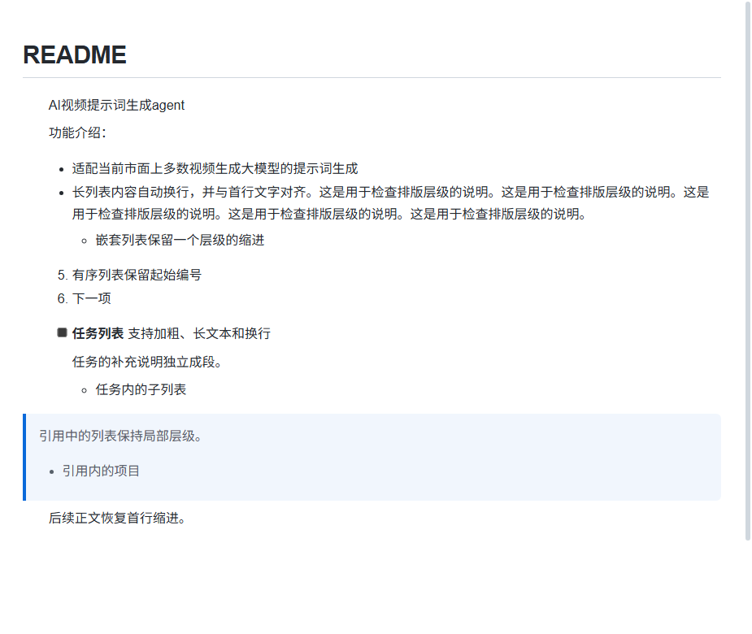

# MdNote 0.3.14 发布记录

发布日期：2026-10-28。基线：`2b4f242`（0.3.13）。

正文仍采用两个字符的首行缩进。正文级有序、无序和任务列表统一使用 3.8em 的内容缩进，让列表标记和文字进一步内收；嵌套列表、引用与目录维持 1.8em 的局部列表缩进，避免逐层重复叠加正文缩进。所有尺寸随字体大小变化。

## 修复与体验改进

- 列表长文本换行后与首行内容对齐，嵌套子项保持层级。
- 任务列表从横向 flex 改为正常块流，复选框置于标记区域，加粗、链接、多段内容和子列表正确排版。
- 修复多段任务的任务标记未识别，以及净化时任务列表类名被移除的问题。
- 父项任务快捷键只处理当前项，保留子任务的勾选状态；即时新建任务补齐相同样式。
- 保留即时输入有序列表的起始编号，并修正列表标记转换后的光标位置。
- 新输入的普通 div 段落沿用正文首行缩进；图片段落不额外缩进。
- 编辑器与 HTML/PDF/PNG/JPEG 导出读取同一份 `typography.css`；导出的有序列表保留 `start`，安全 HTML 保留 `li value`。
- 回归发现 Chromium 会依据新增的视觉缩进重组列表转标题/正文的插入操作。现在仅在同步编辑事务期间暂停视觉附加缩进，再立即恢复；撤销/重做、列表前后的正文、编号和嵌套内容完整保留。

## 验证

新增 9 项真实 WebEngine 回归，覆盖不同字体与窄窗口、正文/嵌套/引用/目录的布局几何、多段任务的块流与保存、父子任务快捷键、列表起始编号与光标，以及列表前接标题、引用、代码、表格、空段、公式时的转换和撤销重做。已有列表转标题/正文回归也全部通过。

| 项目 | 结果 |
| --- | --- |
| Python 全量 | 250 项：249 通过、1 个 Windows 目录符号链接权限场景跳过；127.283 秒 |
| JavaScript | 55 项全部通过 |
| 打包源码 | 30 个 Python 模块、70 个 Web 资源与源码一致；包内版本 0.3.14 |
| 打包页面验证 | 加载打包后的 Web 资源，9 项排版回归全部通过 |
| 构建 | PyInstaller 与 NSIS 编译通过，VC 运行时已同步 |
| 完整性 | 7-Zip 测试通过 |
| 安装包 | `MdNote-Setup-0.3.14.exe`，149,560,640 字节（约 149.6 MB） |
| SHA256 | `1987fdd1fe7d96be4f85e904fe99388b90d1e6c635567be0ef3e516ed61e1381` |

发布页：[MdNote 0.3.14](https://github.com/Wjkstra/md_tools/releases/tag/v0.3.14)。附件包含安装包、`latest.json` 和 `SHA256SUMS.txt`。先推送标签并验证草稿附件，再公开 Release，最后推送主分支更新清单。

本轮未执行真实安装、升级或卸载。工作区原有的 `docs/测试文档.md` 未纳入提交。[机器可读证据](release-0.3.14-evidence.json)保留测试和构建摘要。
